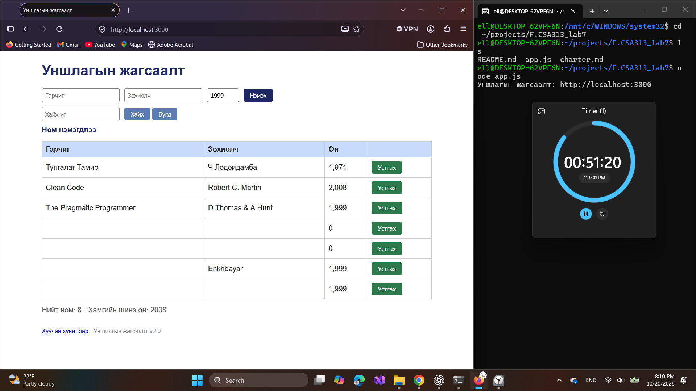
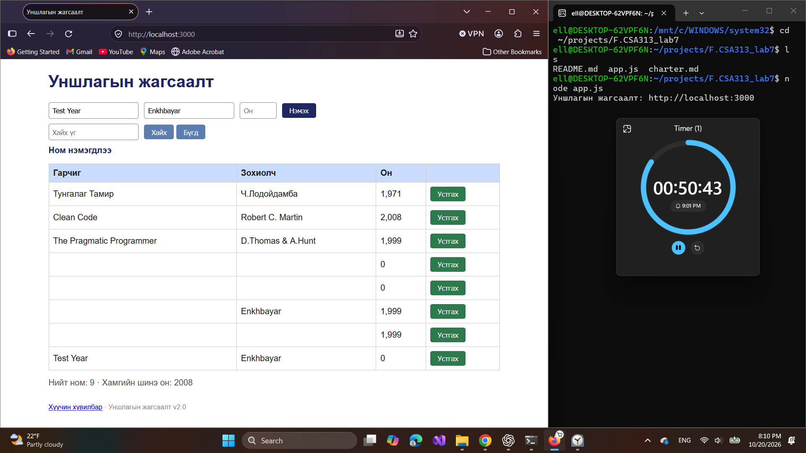

# BUG-01: Дутуу талбартай ном нэмэгдэж байна

Орчин: Уншлагын жагсаалт v2.0; WSL2 Ubuntu, Node.js v18.19.1; Windows Firefox 158.0; 2026-10-20.

Урьдчилсан нөхцөл: `node app.js`-ийг шинээр асааж, Firefox-д `http://localhost:3000` нээсэн; анхны 3 номтой. Өмнөх хайлт, нэмсэн өгөгдөлд тулгуурлахгүй.

## Дахин гаргах алхам

1. Гарчгийг хоосон, зохиолчийг `Enkhbayar`, оныг `1999` болгож «Нэмэх» дарна.
2. Гарчиггүй шинэ мөр болон мессежийг ажиглана.
3. Оны хувилбарыг шалгахдаа аппыг дахин шинээр асааж, гарчиг `Test Year`, зохиолч `Enkhbayar`, он хоосон байхад «Нэмэх» дарна.

Хүлээгдэж байсан: Спецификацийн дагуу гарчиг, зохиолч, он бүгд шаардлагатай; дутуу үед ном нэмэгдэхгүй, ойлгомжтой алдаа гарна.

Бодит үр дүн: Session-д гарчиггүй `Enkhbayar / 1,999` мөр, он хоосон үед `Test Year / Enkhbayar / 0` мөр нэмэгдэж, «Ном нэмэгдлээ» харагдсан. Хоёр хоосон талбарын хувилбар мөн зурагтай; дан зохиолч хоосон кейсийг тусад нь батлаагүй.

Ноцтой байдал: Major — шаардлагатай өгөгдөлгүй бичлэг хадгалж байна.

Олдсон аялал: Couch Potato.

Дутуу талбарын хувилбаруудыг нэг согогт нэгтгэсэн; зургууд нь session-ийн өмнөх нэмэлт мөрүүдтэй төлөвүүд юм.

Баталгаажуулалт: session-ийн зураг, тэмдэглэлд тулгуурласан. Энэ commit-д Firefox дээр шинээр асаасан төлөвөөс UI-ийн дахин шалгалт хийгдээгүй.

## Хавсралт

