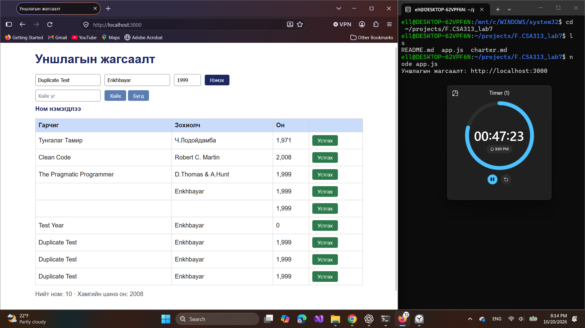
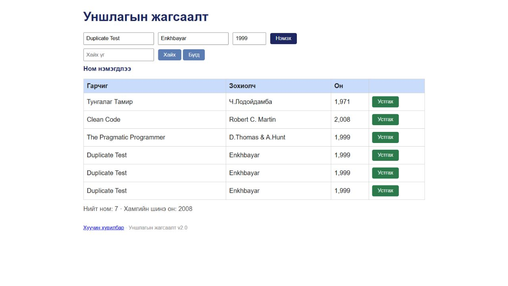

# BUG-02: Ижил гарчиг, зохиолчтой ном давхар нэмэгдэж байна

Орчин: Уншлагын жагсаалт v2.0; WSL2 Ubuntu, Node.js v18.19.1; Windows Firefox 158.0; 2026-10-20.

Урьдчилсан нөхцөл: `node app.js`-ийг шинээр асааж, Firefox-д `http://localhost:3000` нээсэн; анхны 3 номтой. Өмнөх хайлт, нэмсэн өгөгдөлд тулгуурлахгүй.

## Дахин гаргах алхам

1. Гарчиг `Duplicate Test`, зохиолч `Enkhbayar`, он `1999` оруулж «Нэмэх» дарна.
2. Ижил гурван утгаар дахин «Нэмэх» дарна.
3. Зураг дахь гурван давхардлыг харах хувилбарт ижил номыг гурав дахь удаа нэмнэ.

Хүлээгдэж байсан: Ижил гарчиг, зохиолчтой ном ганц байх бөгөөд дараагийн нэмэлтийг зөвшөөрөхгүй.

Бодит үр дүн: Session-ийн зурагт `Duplicate Test / Enkhbayar / 1,999` гэсэн ижил гурван мөр, «Ном нэмэгдлээ» мессеж байна.

Ноцтой байдал: Major — давхардсан бичлэгээс хамгаалах дүрэм ажиллахгүй.

Олдсон аялал: Couch Potato — нэмэх үйлдлийг ижил оролтоор давтах.

Баталгаажуулалт: 2026-10-20-нд шинэ clone-ийн аппыг дахин асааж, Chromium суурьтай апп доторх браузераар зөрчлийг давтан шалгасан. Session-ийн эх зураг нь Firefox-ийнх; доорх recheck зургууд тусдаа.

## Хавсралт

## Дахин шалгасан зураг

