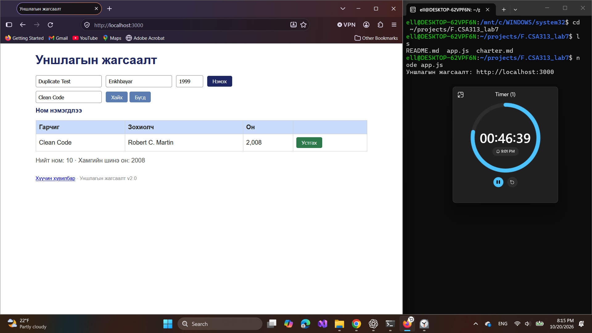
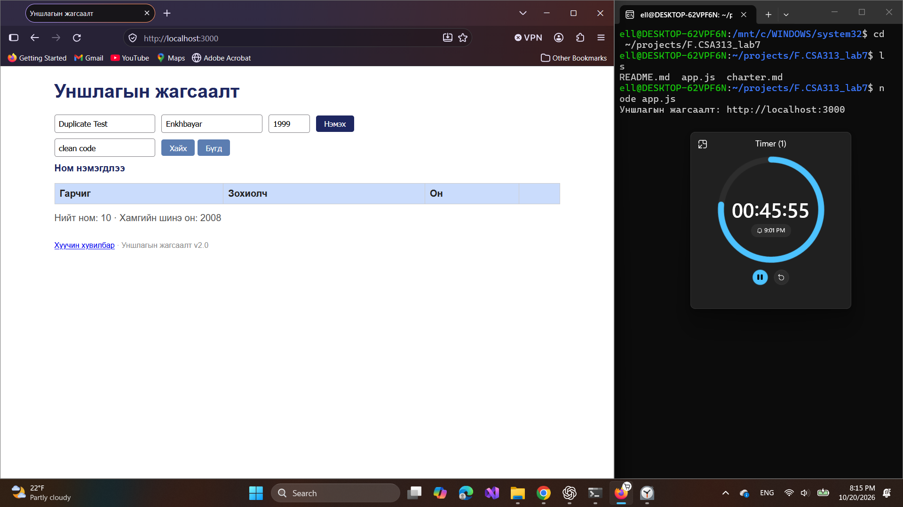
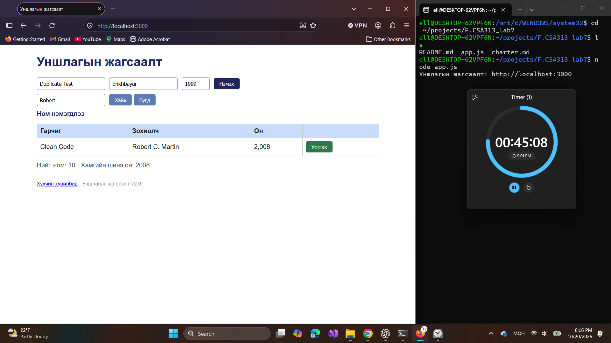

# BUG-03: Гарчиг, зохиолчийн хайлт том жижиг үсэг ялгаж байна

Орчин: Уншлагын жагсаалт v2.0; WSL2 Ubuntu, Node.js v18.19.1; Windows Firefox 158.0; 2026-10-20.

Урьдчилсан нөхцөл: `node app.js`-ийг шинээр асааж, Firefox-д `http://localhost:3000` нээсэн; анхны 3 номтой. Өмнөх хайлт, нэмсэн өгөгдөлд тулгуурлахгүй.

## Дахин гаргах алхам

1. Хайлтад `Clean Code` оруулж «Хайх» дарна; нэг ном олдохыг харна.
2. Хайлтыг `clean code` болгож «Хайх» дарна.
3. `CLEAN CODE`-оор давтана.
4. Зохиолчийн хувилбарт `Robert`, дараа нь `robert` гэж хайна.

Хүлээгдэж байсан: Спецификацийн дагуу хайлт үсгийн хэмжээ ялгахгүй; эдгээр оролт бүр Clean Code номыг олно.

Бодит үр дүн: `Clean Code`, `Robert` хайлт нэг мөр олсон; `clean code`, `CLEAN CODE`, `robert` хайлтууд өгөгдлийн мөргүй болсон.

Ноцтой байдал: Major — хүчинтэй хайлт таарах номыг олж чадахгүй.

Олдсон аялал: Couch Potato — хайлтын оролтыг өөрчлөх.

Гарчиг ба зохиолчийн үсгийн хэмжээний хувилбаруудыг нэг согогт нэгтгэв; кодын шалтгааныг тогтоогоогүй.

Баталгаажуулалт: session-ийн зураг, тэмдэглэлд тулгуурласан. Энэ commit-д Firefox дээр шинээр асаасан төлөвөөс UI-ийн дахин шалгалт хийгдээгүй.

## Хавсралт

