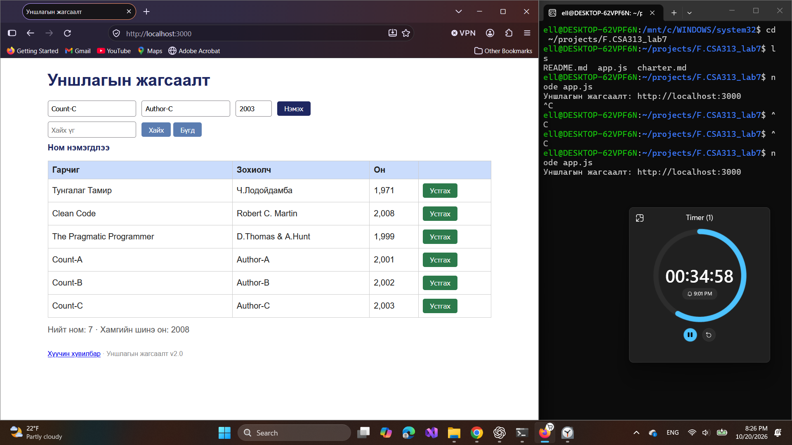
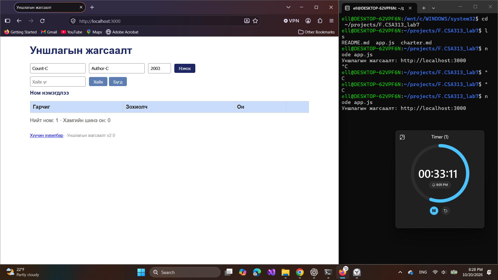
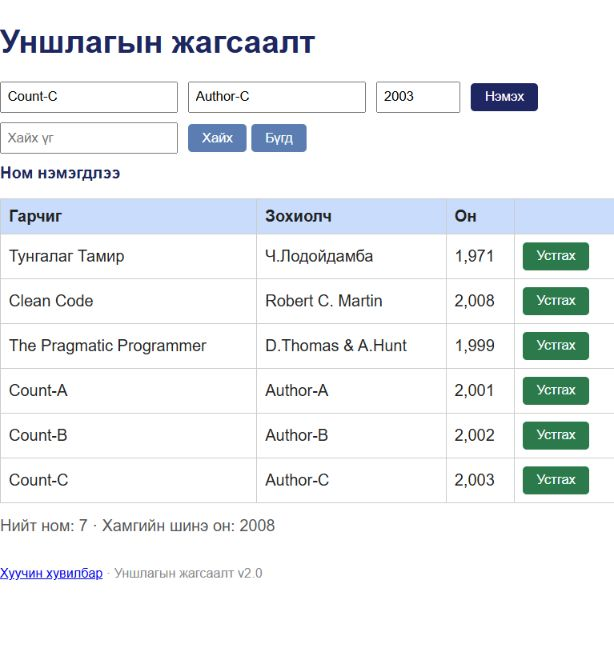
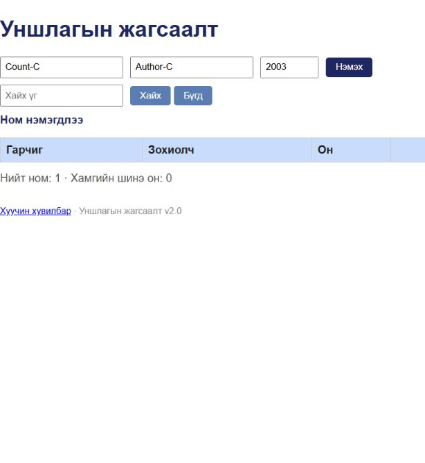

# BUG-04: Нийт номын тоолуур хүснэгтийн мөрийн тоотой таарахгүй

Орчин: Уншлагын жагсаалт v2.0; WSL2 Ubuntu, Node.js v18.19.1; Windows Firefox 158.0; 2026-10-20.

Урьдчилсан нөхцөл: `node app.js`-ийг шинээр асааж, Firefox-д `http://localhost:3000` нээсэн; анхны 3 номтой. Өмнөх хайлт, нэмсэн өгөгдөлд тулгуурлахгүй.

## Дахин гаргах алхам

1. Анхны гурван номын хүснэгтийн мөр болон «Нийт ном»-ыг харьцуулна.
2. `Count-A / Author-A / 2001`, `Count-B / Author-B / 2002`, `Count-C / Author-C / 2003` гэсэн гурван ном нэмнэ.
3. Зургаан өгөгдлийн мөрийг тоолууртай харьцуулна.
4. Хоосон төлөвийг шалгахдаа хайлтыг цэвэрлэж «Бүгд» дарна; үлдсэн мөр бүрийг устгаж, өгөгдлийн мөргүй болсны дараах тоолуурыг харна.

Хүлээгдэж байсан: «Нийт ном» хүснэгтэд буй номын тоотой тэнцэнэ: зургаан мөрт 6, хоосон жагсаалтад 0.

Бодит үр дүн: Session-д 6 мөр байхад тоолуур 7, 5 мөрт 6, 4 мөрт 5, хоосон хүснэгтэд 1 байсан. Хайлтаар 0 мөр болсон үед нийт тоо мөн хэвээр үлдсэн.

Ноцтой байдал: Minor — нийт тооны мэдээлэл хэрэглэгчийг төөрөгдүүлнэ.

Олдсон аялал: Couch Potato — нэмэх, устгах ба хоосон төлөв.

Тайлангийн үндсэн нотолгоо нь хайлтаар шүүгээгүй зургаан мөр болон бүх номыг устгасан хоосон төлөв; шүүсэн жагсаалтын ажиглалтыг нэмэлтээр оруулав.

Баталгаажуулалт: 2026-10-20-нд шинэ clone-ийн аппыг дахин асааж, Chromium суурьтай апп доторх браузераар зөрчлийг давтан шалгасан. Session-ийн эх зураг нь Firefox-ийнх; доорх recheck зургууд тусдаа.

## Хавсралт

## Дахин шалгасан зураг

