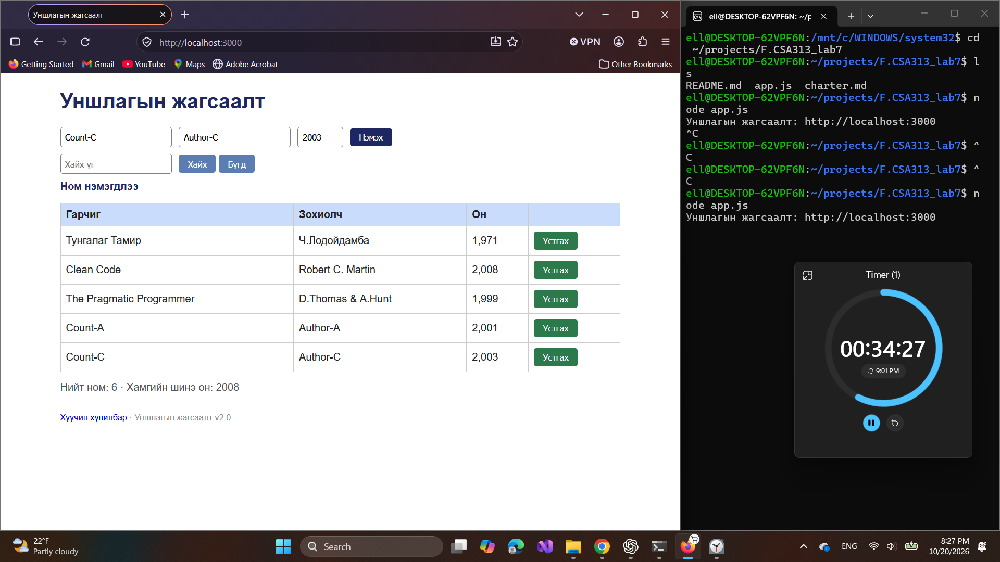
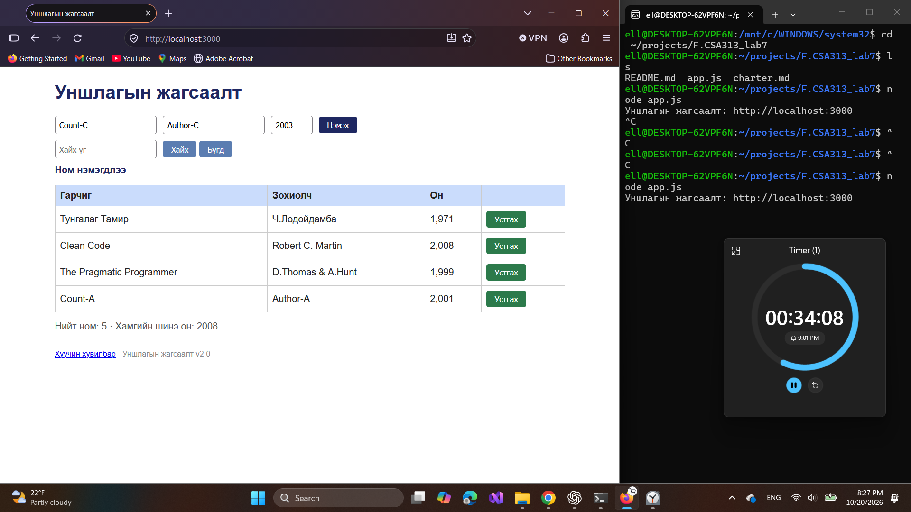
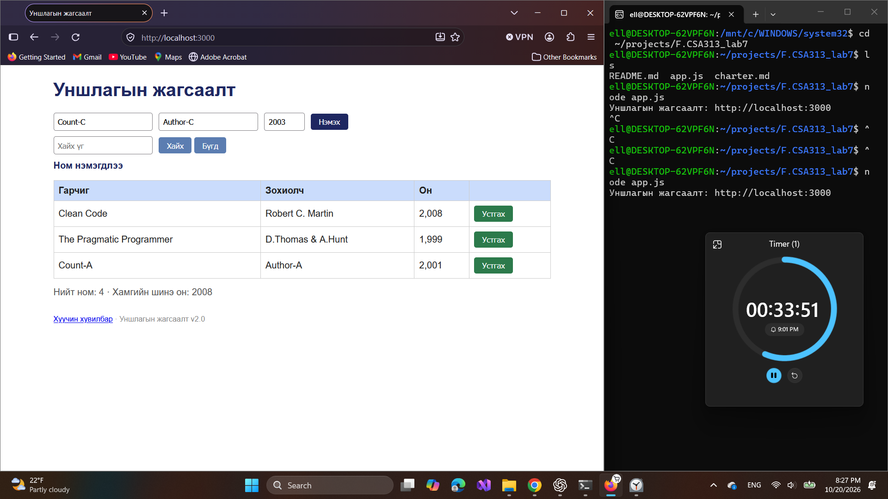

# BUG-05: Ном устгасны дараа нэмэх мессеж хэвээр байна

Орчин: Уншлагын жагсаалт v2.0; WSL2 Ubuntu, Node.js v18.19.1; Windows Firefox 158.0; 2026-10-20.

Урьдчилсан нөхцөл: `node app.js`-ийг шинээр асааж, Firefox-д `http://localhost:3000` нээсэн; анхны 3 номтой. Өмнөх хайлт, нэмсэн өгөгдөлд тулгуурлахгүй.

## Дахин гаргах алхам

1. `Count-A / Author-A / 2001` ном нэмнэ; «Ном нэмэгдлээ» мессежийг харна.
2. Хайлт хийхгүйгээр хүснэгтэд буй нэг номын «Устгах»-ыг дарна.
3. Мөр хасагдсаны дараах мессежийг харна.

Хүлээгдэж байсан: Спецификацийн дагуу үйлдлийн дараах мессеж устгасан үйлдэлтэй тохирно.

Бодит үр дүн: Session-ийн дараалсан зургууд дээр мөрүүд хасагдсан ч «Ном нэмэгдлээ» мессеж хэвээр байна.

Ноцтой байдал: Minor — мессеж бодит үйлдэлтэй тохирохгүй.

Олдсон аялал: Couch Potato — нэмэхээс устгах руу шилжих.

Яг дарсан товчны мөч screenshot-д байхгүй; энэ тайлан мессежийн зөрчлийг баримтжуулна. Сонгосон номын асуудлыг BUG-06-д тусад нь тэмдэглэсэн.

Баталгаажуулалт: session-ийн зураг, тэмдэглэлд тулгуурласан. Энэ commit-д Firefox дээр шинээр асаасан төлөвөөс UI-ийн дахин шалгалт хийгдээгүй.

## Хавсралт

