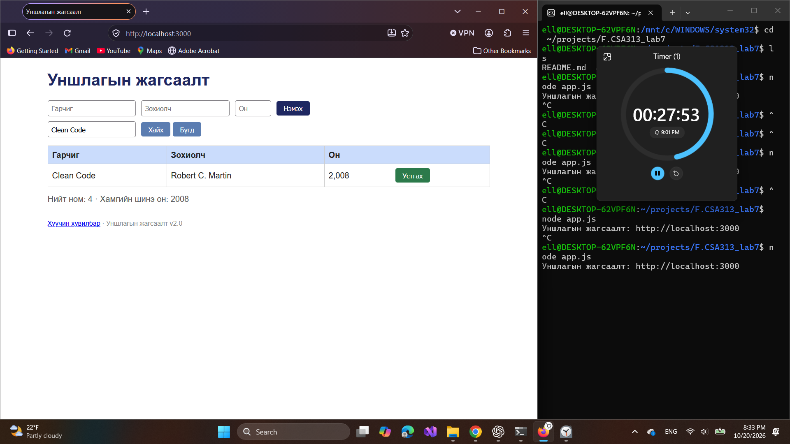
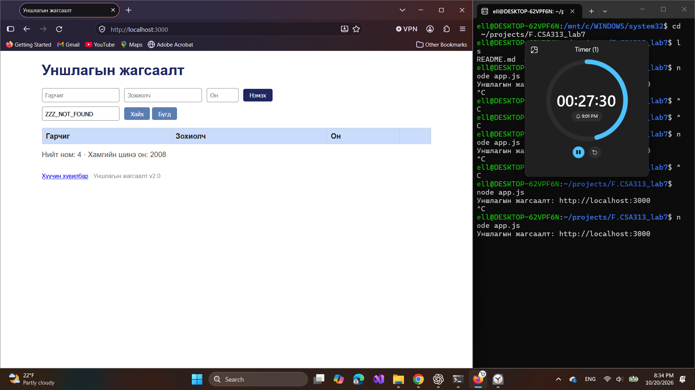
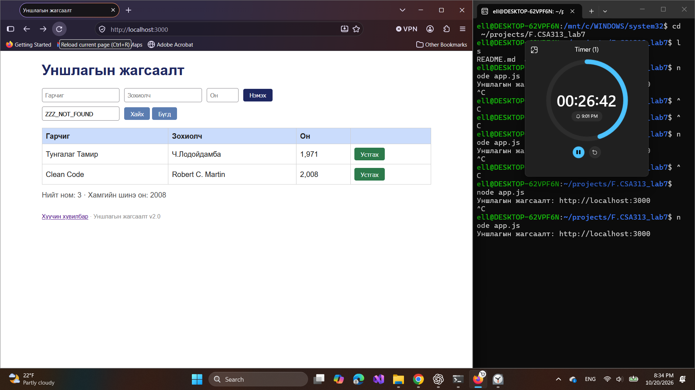
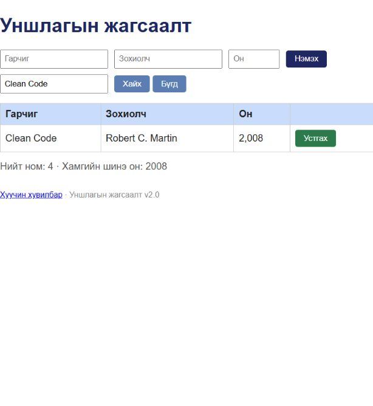
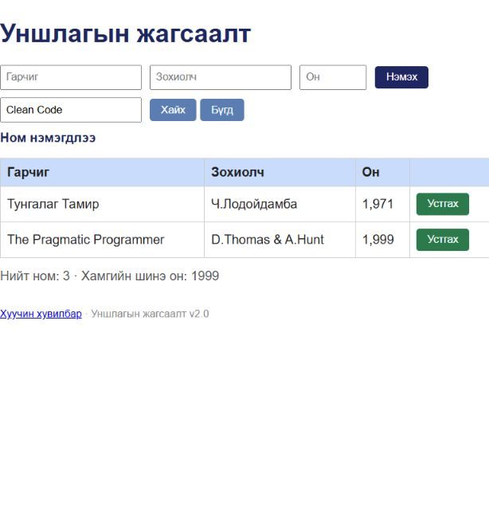

# BUG-06: Clean Code-г устгах үед өөр ном алга болсон ажиглалт

Орчин: Уншлагын жагсаалт v2.0; WSL2 Ubuntu, Node.js v18.19.1; Windows Firefox 158.0; 2026-10-20.

Урьдчилсан нөхцөл: `node app.js`-ийг шинээр асааж, Firefox-д `http://localhost:3000` нээсэн; анхны 3 номтой. Өмнөх хайлт, нэмсэн өгөгдөлд тулгуурлахгүй.

## Бүртгэгдсэн үйлдэл ба дутуу алхам

Clean Code-г хайсан зураг, дараа нь ZZZ_NOT_FOUND хайлттай зураг, Clean Code үлдэж өөр ном алга болсон зураг байна. Сонгосон «Устгах»-ын өмнөх хайлт/Бүгд/refresh-ийн дараалал тодорхойгүй тул шинээр асаасан төлөвөөс яг давтагдах алхам жагсаагаагүй.

Хүлээгдэж байсан: Clean Code мөрийн «Устгах»-ыг дарвал тэр ном алга болж, бусад ном хэвээр үлдэнэ.

Бодит үр дүн: Session-ийн дараах зурагт Тунгалаг Тамир ба Clean Code үлдсэн, The Pragmatic Programmer харагдахгүй. Clean Code-г устгахыг дарснаа тест хийсэн хүн баталсан боловч хайлт, «Бүгд», refresh-ийн яг дарааллыг санахгүй байна.

Ноцтой байдал: Major (урьдчилсан) — буруу ном устаж болзошгүй.

Олдсон аялал: Couch Potato — хайлт ба устгалын харилцан үйлчлэл.

Төлөв: шинэ clone дээрх нэг тодорхой оролдлогод давтагдаагүй. Session-ийн яг дараалал баталгаажаагүй тул давтагдсан согогийн тоонд оруулахгүй.

## Хавсралт

## Дахин шалгалт

Шинээр асаасан апп → Clean Code гэж хайх → гарсан мөрийн Устгах товчийг дарах дарааллаар Clean Code зөв устаж, Тунгалаг Тамир болон The Pragmatic Programmer үлдсэн. Энэ нь session-ийн сэжгийг няцаасан бүрэн шалгалт биш боловч уг дарааллаар буруу ном устахыг батлаагүй. Session-ийн эх ажиглалтыг хэвээр хадгалав.

