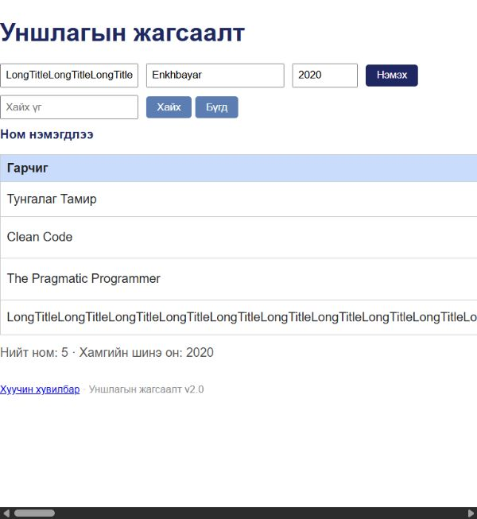

# BUG-07: Зайгүй урт гарчиг хүснэгтийг цонхноос хэт өргөсгөж байна

Орчин: Уншлагын жагсаалт v2.0; WSL2 Ubuntu, Node.js v18.19.1; Windows Firefox 158.0; 2026-10-20.

Урьдчилсан нөхцөл: `node app.js`-ийг шинээр асааж, Firefox-д `http://localhost:3000` нээсэн; анхны 3 номтой. Өмнөх хайлт, нэмсэн өгөгдөлд тулгуурлахгүй.

## Дахин гаргах алхам

1. Браузерийн цонхыг ойролцоогоор 600–1300 пиксел өргөнтэй болгоно.
2. Гарчигт `LongTitle` үгийг зайгүй 100 удаа давтсан 900 тэмдэгттэй текст, зохиолч `Enkhbayar`, он `2020` оруулна.
3. «Нэмэх» дараад хүснэгтийн өргөн, баруун талын үйлдлийн багана, хэвтээ scrollbar-ыг шалгана.

Хүлээгдэж байсан: Спецификацийн дагуу ямар ч урт оролтод хүснэгт эвдрэхгүй; текст болон үйлдлүүд ашиглах боломжтой байна.

Бодит үр дүн: Session-д зайгүй урт гарчиг нэг мөрөөр сунан хүснэгт цонхноос хэтэрсэн. Хэвтээ scrollbar гарч, нэг тал руу гүйлгэхэд нөгөө талын баганууд харагдахгүй болсон.

Ноцтой байдал: Minor — баганууд, үйлдлүүдийг харахад хэвтээ гүйлгэх шаардлагатай болж байна.

Олдсон аялал: Supermodel.

Session-д оруулсан давталтын яг тоо бүртгэгдээгүй. Дараах дахин шалгалтад LongTitle × 100 буюу 900 тэмдэгт хэрэглэсэн: viewport 614 px байхад хүснэгт 6806 px өргөн болсон. Энэ нь session-ийн үл мэдэгдэх уртыг таамагласан утга биш, шинэ давтагдах оролт юм. Зохиолчийн олон мөрийг дангаар нь тусдаа согог гэж тооцоогүй.

Баталгаажуулалт: 2026-10-20-нд шинэ clone-ийн аппыг дахин асааж, Chromium суурьтай апп доторх браузераар зөрчлийг давтан шалгасан. Session-ийн эх зураг нь Firefox-ийнх; доорх recheck зургууд тусдаа.

## Хавсралт

## Дахин шалгасан зураг

