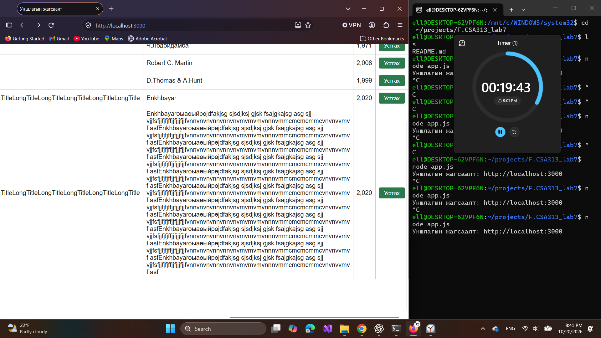
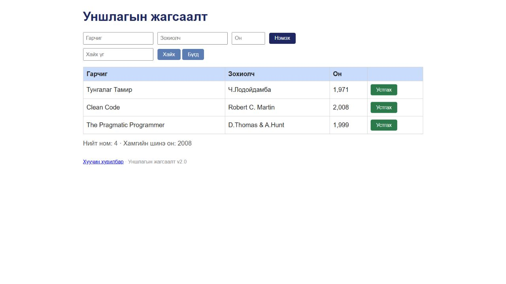

# BUG-09: Аюултай Устгах товч улаан биш ногоон байна

Орчин: Уншлагын жагсаалт v2.0; WSL2 Ubuntu, Node.js v18.19.1; Windows Firefox 158.0; 2026-10-20.

Урьдчилсан нөхцөл: `node app.js`-ийг шинээр асааж, Firefox-д `http://localhost:3000` нээсэн; анхны 3 номтой. Өмнөх хайлт, нэмсэн өгөгдөлд тулгуурлахгүй.

## Дахин гаргах алхам

1. Анхны гурван номтой хуудсыг нээнэ.
2. Хүснэгтийн мөрүүдийн «Устгах» товчны дэвсгэр өнгийг харна.

Хүлээгдэж байсан: Спецификацийн дагуу Устгах товч улаан өнгөтэй байна.

Бодит үр дүн: Session-ийн зурагт Устгах товчнууд ногоон дэвсгэртэй.

Ноцтой байдал: Minor — аюултай үйлдлийн өнгөний дохио спецификацитай зөрсөн.

Олдсон аялал: Supermodel.

Баталгаажуулалт: 2026-10-20-нд шинэ clone-ийн аппыг дахин асааж, Chromium суурьтай апп доторх браузераар зөрчлийг давтан шалгасан. Session-ийн эх зураг нь Firefox-ийнх; доорх recheck зургууд тусдаа.

## Хавсралт

## Дахин шалгасан зураг

