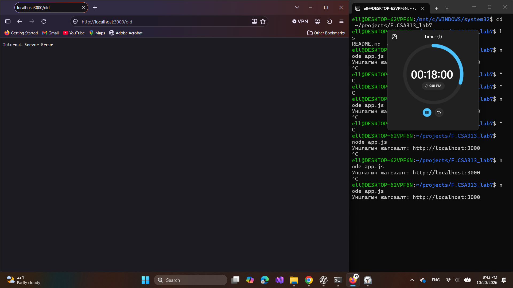

# BUG-10: Хуучин хувилбарын линк HTTP 500 алдаа буцааж байна

Орчин: Уншлагын жагсаалт v2.0; WSL2 Ubuntu, Node.js v18.19.1; Windows Firefox 158.0; 2026-10-20.

Урьдчилсан нөхцөл: `node app.js`-ийг шинээр асааж, Firefox-д `http://localhost:3000` нээсэн; анхны 3 номтой. Өмнөх хайлт, нэмсэн өгөгдөлд тулгуурлахгүй.

## Дахин гаргах алхам

1. Firefox-д «Хуучин хувилбар» линкийг дарна.
2. Хаяг `/old` болсон болон `Internal Server Error` текстийг ажиглана.
3. HTTP түвшинд доорх curl командаар статус, body-г шалгана.

```bash
curl -i --max-time 10 http://localhost:3000/old
```

Хүлээгдэж байсан: «Бүх хуудас, линк ажиллана» гэсэн дүрмийн дагуу хуучин хувилбарын хуудас серверийн алдаагүй нээгдэнэ.

Бодит үр дүн: HTTP/1.1 500 Internal Server Error; body нь `Internal Server Error`. Шинээр асаасан апп дээр 2026-10-20 21:09:57 (UTC+08:00)-д curl-аар дахин баталсан.

Ноцтой байдал: Major — хуудас нээгдэхгүй, серверийн алдаа гарна.

Олдсон аялал: Supermodel — линк; Saboteur — curl баталгаажуулалт.

## Хавсралт



- [curl — bug-10-curl.txt](../evidence/bug-10-curl.txt)
- [curl — recheck/bug-10-curl.txt](../evidence/recheck/bug-10-curl.txt)

Шинэ clone-ийн эцсийн HTTP шалгалт: [бүтэн curl гаралт](../evidence/recheck/final-clone-old-curl.txt).
