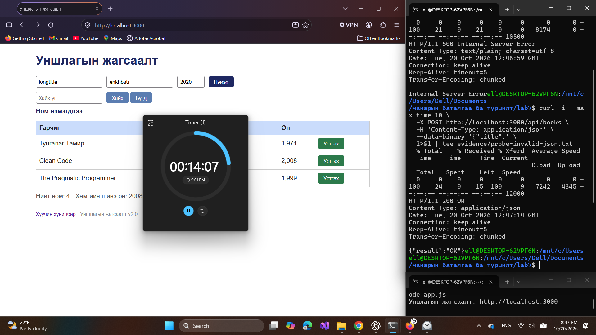

# BUG-11: Буруу JSON POST-д HTTP 400-ийн оронд 200 ба OK буцааж байна

Орчин: Уншлагын жагсаалт v2.0; WSL2 Ubuntu, Node.js v18.19.1; Windows Firefox 158.0; 2026-10-20.

Урьдчилсан нөхцөл: `node app.js`-ийг шинээр асааж, Firefox-д `http://localhost:3000` нээсэн; анхны 3 номтой. Өмнөх хайлт, нэмсэн өгөгдөлд тулгуурлахгүй.

## Дахин гаргах алхам

1. Шинээр асаасан аппын анхны гурван номтой төлөвөөс доорх curl командаар синтаксын хувьд дутуу JSON илгээнэ.
2. HTTP статус болон body-г харна.
3. Нэмэлт хувилбарт raw body-г `not-json`, дараа нь `{"title":"API Test",}` болгон тус тус шалгана; ижил шалтгааны хувилбарууд гэж нэгтгэнэ.

```bash
curl -i --max-time 10 -X POST http://localhost:3000/api/books \
  -H 'Content-Type: application/json' \
  --data-binary '{"title":'
```

Хүлээгдэж байсан: Спецификацийн дагуу буруу JSON биетэй POST хүсэлт HTTP 400 буцаана; `OK` гэж хариулахгүй.

Бодит үр дүн: Бүх бүртгэсэн буруу JSON хувилбарт HTTP/1.1 200 OK, `{"result":"OK"}` буцсан. Үндсэн дутуу JSON хувилбарыг шинээр асаасан апп дээр 2026-10-20 21:09:57 (UTC+08:00)-д дахин баталсан.

Ноцтой байдал: Major — API алдаатай хүсэлтийг амжилттай гэж мэдэгдэж байна.

Олдсон аялал: Saboteur.

Session-ийн GET before/after body ижил гурван номтой байсан. Буруу JSON шинэ эсвэл хоосон бичлэг нэмсэн гэж энэ тайланд дүгнээгүй.

## Хавсралт



- [curl — bug-11-curl.txt](../evidence/bug-11-curl.txt)
- [curl — bug-11-plain-text-curl.txt](../evidence/bug-11-plain-text-curl.txt)
- [curl — bug-11-trailing-comma-curl.txt](../evidence/bug-11-trailing-comma-curl.txt)
- [curl — recheck/bug-11-curl.txt](../evidence/recheck/bug-11-curl.txt)
